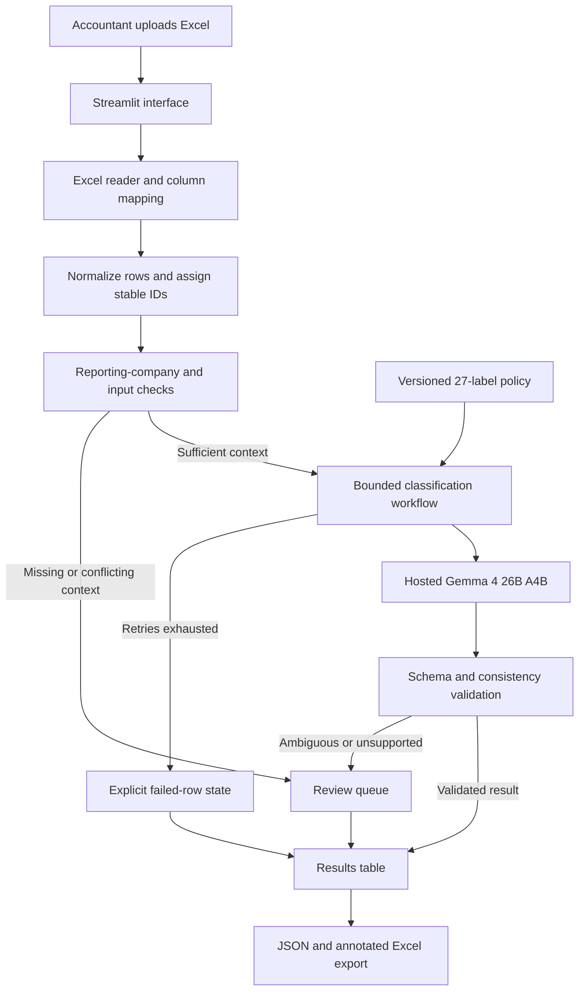
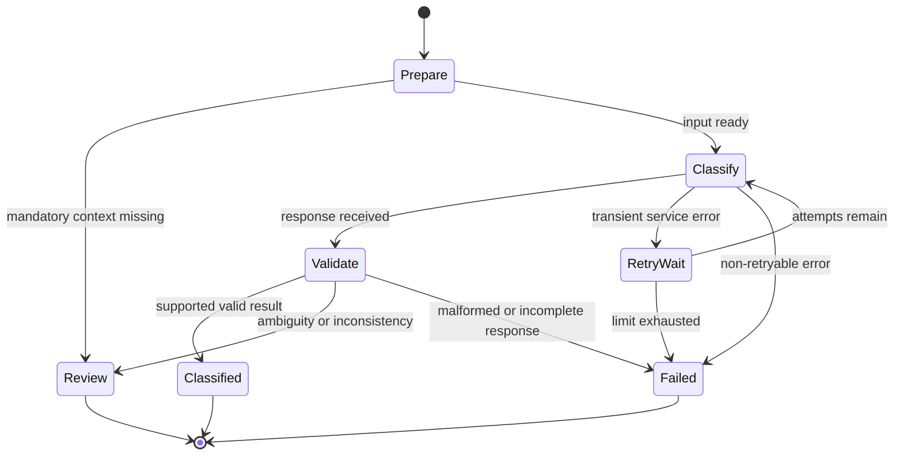

# 1. Project Name

## VYOM+ — Evidence-Backed Voucher Classification

**From structured transactions to accounting-aware, multi-label voucher recommendations.**

**Problem statement:** PS 4 — Intelligent Voucher Classification Using Open-Source LLMs

**Event:** Elevate — Hacktober Fest Open Source AI Hackathon

**Stage:** Qualifier technical proposal · 3–8 October 2026

**Proposed final implementation:** 10 October 2026, subject to organizer communication

> **Proposal status:** This README describes the system we propose to implement in the final hackathon. Preliminary model experiments inform its feasibility; the complete Excel-to-output application has not yet been built. This qualifier submission contains only `README.md`.

---

# 2. Problem Statement

Accounting systems need to identify what a transaction means before creating the appropriate voucher. Even when invoice and transaction information is already structured, classification requires reasoning across fields: whose books are being prepared, who bought or sold goods, whether money actually moved, whether ownership changed, and whether the record describes an order, invoice, return, or adjustment.

Keyword matching is insufficient. A record containing “payment” may describe future payment terms, while a salary disbursement can legitimately support both **Salary / Payroll** and **Payment**. The same invoice is a Purchase for its buyer and a Sales transaction for its seller.

VYOM+ will accept structured Excel rows and recommend all supported voucher categories, with machine-readable output and explicit review handling.

### Scope confirmed with the organizer

The following clarifications guide this proposal where the initial PS is ambiguous:

- The task is **multi-label**: return all applicable categories, rather than exactly one category per row.
- The dataset identifies the company whose books are being classified.
- The category list contains **27 labels**.
- Categories such as Attendance and Physical Stock can fall outside Payment, Purchase, and Sales.
- Expected and predicted tags will be compared manually or algorithmically; the exact official scoring formula has not been supplied.
- API-based inference is permitted when the selected AI model is open source.

**Input is already structured. OCR, invoice extraction, and automatic posting into an accounting ledger are outside the core implementation.**

# 3. Project Overview

VYOM+ is a proposed accounting classification workbench for finance teams and ERP integrators. A user uploads an Excel workbook, confirms the relevant column mapping, and receives a row-level set of voucher recommendations.

Each result will retain its source-row identity and distinguish between:

- **Classified:** valid recommendations were generated and passed application checks.
- **Needs review:** missing or conflicting information prevents a reliable automatic decision.
- **Failed:** processing or inference did not complete successfully after bounded recovery.

The system will combine an open model's semantic interpretation with deterministic input checks, output validation, and evaluation. Its contribution is the accounting-aware workflow and inspectable decisions, not a generic chat interface.

# 4. Proposed Solution

### A. Normalize the structured input

Read `.xlsx` rows, preserve the original values, assign stable transaction IDs, and map available columns into a canonical transaction representation. Preserve identifiers as text and distinguish missing information from zero or false.

### B. Establish the reporting perspective

Identify the reporting company from the supplied dataset. Prefer stable company identifiers where available; support exact normalized names where necessary. Derive explicit facts such as “reporting entity is buyer,” “reporting entity is seller,” or “both accounts belong to the reporting entity.” Unresolved identity matches will be flagged rather than guessed.

### C. Classify against a versioned accounting policy

Provide the normalized row, reporting perspective, and a compact 27-label policy to **Gemma 4 26B A4B IT** through a hosted API. Ask for all supported tags and a review flag in concise JSON. The policy will distinguish the event actually recorded from related events that might occur later.

### D. Validate and route the result

Check the label vocabulary, duplicates, output structure, and available supporting fields. Detect deterministic inconsistencies where the input provides explicit evidence. Unsupported model responses will never be silently converted into successful classifications.

### E. Make the result inspectable and exportable

Display predictions alongside original fields. Let the user inspect short, field-linked explanations on demand and download JSON and annotated Excel output. Evidence explanations are an aid to review, not proof that a tag is correct.

### Illustrative distinctions

| Transaction context | Intended interpretation |
|---|---|
| Reporting company is seller on an unpaid goods invoice | Sales; unpaid terms do not establish Receipt |
| Employee salaries actually transferred | Salary / Payroll + Payment |
| Employee salaries calculated but not disbursed | Salary / Payroll |
| Transfer between the company's own bank accounts | Contra |
| Physical warehouse count, no adjustment posted | Physical Stock |
| Imported purchase invoice, no settlement recorded | Purchase + Import |
| Purchase order before delivery or invoicing | Purchase Order |

These examples illustrate our working policy. The organizer's examples will take precedence over provisional interpretations, particularly for overlapping inventory, expense, and reversal categories.

# 5. Objectives

1. Predict all evidence-supported categories from the fixed 27-label vocabulary.
2. Interpret every transaction from the specified reporting company's perspective.
3. Distinguish invoices, settlements, orders, returns, stock movements, and adjustments.
4. Preserve traceability from every result to its source Excel row.
5. Handle incomplete or ambiguous input with explicit review states.
6. Produce validated JSON and annotated Excel output suitable for downstream integration.
7. Provide a reproducible evaluation method covering correctness, robustness, latency, and failed-row coverage.
8. Deliver an achievable final-round application using meaningful open-source AI integration.

# 6. Target Users / Use Case

### Primary users

- **Accountants and bookkeeping teams:** classify imported transaction records and inspect exceptions.
- **Finance operations teams:** reduce repetitive category selection before voucher preparation.
- **ERP and accounting integrators:** consume normalized classification output downstream of extraction or data-entry systems.

### Representative workflow

An accountant receives an Excel workbook containing mixed goods invoices, bank settlements, payroll entries, orders, and inventory documents. The workbook identifies the reporting company but omits voucher categories. VYOM+ processes the rows, highlights records requiring review, and exports the original data with classification results.

The accountant remains responsible for reviewing exceptions and authorizing any subsequent voucher creation or ledger posting.

# 7. Open-Source AI Technology Selected

### Primary model: Google Gemma 4 26B A4B IT

- **Hosted model identifier verified during feasibility testing:** `gemma-4-26b-a4b-it`.
- **Model family license:** Apache-2.0, as documented in the official Gemma 4 model card.
- **Architecture:** mixture-of-experts, approximately 25.2B total parameters and 3.8B active parameters.
- **Use in VYOM+:** text-based multi-field interpretation and multi-label voucher classification.
- **Deployment:** hosted inference accessed through the Google API; model execution does not take place on the user's laptop.

**Gemma is the selected open model. The Gemini API is the hosted service used to access it; the project does not use a proprietary Gemini model as its classifier.** Our account's model listing and successful generation requests confirmed access to Gemma 4 26B A4B IT.

The hosted service itself is not claimed to be open source. The selected model and supporting application libraries provide the open-source components.

**Supporting workflow technology:** LangGraph, used for a small, explicit stateful workflow rather than an autonomous multi-agent conversation.

**Primary references:** [Official Gemma 4 collection](https://huggingface.co/collections/google/gemma-4) · [Gemma 4 model-family documentation and license](https://huggingface.co/google/gemma-4-31B-it) · [LangGraph](https://github.com/langchain-ai/langgraph)

# 8. Why This Technology Was Selected

### Selection was driven by measured task behavior

Exploratory local tests with quantized Qwen, Phi, and Ministral variants exposed repeated perspective errors, unsupported extra tags, and weak missing-context handling. Local Qwen3-8B ran on the available 8 GB laptop but used approximately 5.94 GB of model memory reported by Ollama, leaving limited headroom.

Hosted Gemma 4 26B A4B produced substantially more promising results on the development cases while removing local model-memory pressure. Its open license, configurable deployment options, and ability to interpret multiple fields suit the PS.

### Preliminary feasibility findings

| Experiment | Observed result |
|---|---|
| Same 8 basic cases, original hosted prompt | 8/8 exact tag sets; 10.3 seconds mean request time |
| Same 8 cases, concise hosted prompt | 8/8 exact tag sets; 7.3 seconds mean request time |
| 20 fresh development cases, before deterministic missing-entity handling | 18/19 exact tag sets; contradiction review correct; 8.7 seconds mean |
| 35-case regression with concise prompt and input check | 33/34 planned exact-tag cases succeeded; one unresolved API error in that pass; contradiction review correct |

**Interpretation and limitations:**

- These are small synthetic development experiments, not representative real-world accuracy claims.
- Fresh cases and expected labels were written before their evaluation, but were not independently reviewed by an accountant or organizer.
- One fresh case exposed an incorrect guess when the reporting company was absent. A deterministic input check now routes missing-company records to review without calling the model.
- The unresolved API request later succeeded on a targeted rerun; the earlier full-run score remains 33/34, not a rewritten perfect score.
- Latency figures are sequential observations, not guarantees. Prompt roles, output constraints, and reasoning budgets differed between local and hosted experiments, so these are system-level observations rather than a controlled model ranking.
- The faster prompt reduced mean latency by approximately 29% on the eight-case comparison; it did not establish sub-second inference or spreadsheet-scale throughput.

### Why an open-model approach suits the project

The model can be evaluated transparently, replaced behind an inference adapter, and potentially self-hosted later on suitable hardware. This reduces dependence on one model vendor's closed model family while preserving a practical hosted option for the hackathon.

# 9. AI's Role in the System

The model is the **primary semantic interpretation layer**. It will infer the event represented by a row from combinations of descriptions, parties, payment evidence, document references, ownership, and movement information.

AI will be used to:

- Interpret varied transaction descriptions and incomplete contextual clues.
- Distinguish semantically similar categories.
- Select multiple applicable tags where independent evidence supports each.
- Identify ambiguity beyond deterministic field checks.
- Produce short explanations linked to source fields when requested.

Deterministic application logic will handle:

- File parsing, arithmetic checks, identifiers, and data normalization.
- Exact company/account identity matches and mandatory context checks.
- Schema and allowed-label validation.
- Retry limits, row coverage, failed states, and exports.

The application will not invent missing fields or treat a model-generated confidence number as a calibrated probability. Numerical confidence is not an MVP requirement.

# 10. System Architecture



The Streamlit process will host the UI and application workflow for the final MVP. Calls to the hosted model will be made server-side. A separate frontend service, API server, database, or vector database is not required for this scope.

# 11. Component-Level Architecture

| Component | Responsibility | Input → output |
|---|---|---|
| Workbook adapter | Read selected sheet; validate headers; preserve original values | `.xlsx` → source rows |
| Schema mapper | Confirm mappings for available columns | Headers + user mapping → canonical fields |
| Transaction normalizer | Normalize dates/values, preserve IDs, distinguish nulls | Source row → normalized transaction |
| Entity-context resolver | Establish the reporting perspective using explicit identifiers | Transaction → role/ownership facts or review reason |
| Accounting policy | Define tags, supported overlaps, exclusions and examples | Versioned definitions → prompt context |
| LangGraph workflow | Coordinate preparation, inference, validation and terminal states | Row state → classified/review/failed state |
| Inference adapter | Construct Gemma request, measure usage, handle bounded recovery | Context + policy → raw structured response |
| Result validator | Check exact labels, duplicates, structure and evidence consistency | Response + source row → validated result or review/failure |
| Review/evidence view | Show source fields, issues and optional explanations | Result → inspectable decision |
| Export adapter | Preserve one output entry per input row | Results → JSON and annotated workbook |
| Evaluation runner | Compare with independently prepared labels and measure latency | Frozen test records + results → metrics and error analysis |

No component will silently omit rows that fail. UI counts will reconcile total input rows against classified, review-required, and failed rows.

# 12. Data / Information Flow

1. **Upload:** accept an Excel workbook and select its transaction sheet.
2. **Map:** inspect available headers and confirm their canonical meanings. The exact organizer schema is not yet available.
3. **Normalize:** assign a stable ID based on workbook/sheet/row; retain the invoice number as an optional business reference, not a guaranteed unique key.
4. **Resolve perspective:** attach reporting-company and ownership facts supported by the row.
5. **Check:** route missing mandatory context to review. Preserve uncertainty rather than filling absent values.
6. **Infer:** send the minimum relevant structured fields plus the accounting policy to Gemma. Expected test labels are never sent with evaluation records.
7. **Validate:** check JSON structure, permitted tags, duplicate tags, and known inconsistencies.
8. **Review:** display issues and, when requested, a concise field-linked explanation. Keep raw model output separate from any user-reviewed result.
9. **Export:** return a result for every source row, including review reasons or failure codes.

### Reproducibility and data handling

Record the model identifier, policy/prompt version, generation settings, normalized input, response, attempt count, elapsed time, and token usage where provided. A hosted model alias may change; this limitation will be documented rather than claiming immutable weights.

API credentials will remain in server-side environment variables. The application will not send the entire workbook where only one normalized row is needed. Workbook content will be treated as data, not executable instructions, and retention will be in-memory for the MVP unless the user explicitly downloads results.

# 13. Agentic Workflow (if applicable)

VYOM+ will use a **bounded, stateful AI workflow**, implemented as a small LangGraph graph. It does not require multiple autonomous agents or open-ended planning.



- Maximum **three API attempts total** per classification request, including the initial attempt.
- Backoff for transient failures; honor applicable provider retry guidance.
- Authentication and unsupported-setting errors will be reported without repeated retries.
- Failed rows remain visible and exportable.
- Explanations are optional and on demand, so they do not add latency to every classification.

Reasoning effort will follow the supported provider interface. Our tested Gemma endpoint rejected thinking-budget and thinking-level controls; the proposal does not depend on those controls.

# 14. Technology Stack

| Layer | Proposed choice | Reason |
|---|---|---|
| Application language | Python | Straightforward data processing and model integration |
| UI and application host | Streamlit | Rapid Excel upload, result tables and review interface |
| Excel processing | pandas + openpyxl | Structured workbook ingestion and export |
| Data contracts | Pydantic | Explicit transaction/result schemas and validation |
| Workflow | LangGraph | Inspectable row state and conditional routing |
| Model | Gemma 4 26B A4B IT | Selected open-model semantic classifier |
| Hosted inference | Google API, model `gemma-4-26b-a4b-it` | Verified account access; no local GPU requirement |
| HTTP integration | HTTPX | Server-side requests, timeouts and measured recovery |
| Evaluation | scikit-learn + small custom scorer | Multi-label metrics, coverage, error analysis |
| Version control / proposal | GitHub + Markdown / Mermaid | README-only technical proposal and inline diagrams |

The exploratory model experiments used a separate lightweight Node.js harness. They establish feasibility observations, not the existence of the proposed Python final application. Porting the tested request structure and checks is part of the implementation plan.

# 15. Expected Features

### Final-round MVP

- Excel upload, sheet selection and column mapping.
- Stable source-row tracking and original-field preservation.
- Company-perspective-aware multi-label classification.
- Missing-context checks and review flags.
- Exact-label and JSON validation.
- Bounded retries with visible progress and failed-row states.
- Results table with filters for classified, review-required and failed rows.
- JSON and annotated Excel downloads.
- Optional field-linked explanation for a selected row.
- A reproducible evaluation command or interface for reviewed test records.

### Deliberately deferred

ERP posting, OCR, model fine-tuning, a large retrieval system, autonomous multi-agent debate, and production-scale processing are future extensions. They are not dependencies for a useful final-round demonstration.

# 16. Implementation Approach

### Phase 1 — Confirm the data contract and policy

Inspect the organizer's sample workbook, confirm company identifiers, and map headers. Request representative expected tag sets, particularly for returns, processing-material movements, Expense versus Purchase, and specialized versus generic document tags. Version the resulting policy.

### Phase 2 — Build an end-to-end vertical slice

Implement upload → one normalized row → hosted Gemma request → validation → displayed/exported result. Reproduce a Purchase/Sales perspective pair and a Payroll + Payment example before adding batch processing.

### Phase 3 — Add workbook coverage and exception handling

Process rows sequentially initially. Add progress reporting, timeouts, bounded retries, missing-context review, and explicit failed states. Validate that every input row has a corresponding result.

### Phase 4 — Add evidence inspection and exports

Show source fields supporting the decision and generate concise explanations on demand. Export the original columns plus stable IDs, predicted tags, status, and review/failure information.

### Phase 5 — Evaluate and prepare the demo

Freeze prompts and model settings, run the reviewed test set, inspect errors by category, and measure end-to-end latency and request coverage. Demonstrate normal, overlapping-label, ambiguous, and service-failure paths.

### Reproducible evaluation method

- Prepare independent gold tag sets using organizer examples or accountant review. Synthetic cases supplement those labels rather than replace them.
- Separate policy/prompt development records from heldout evaluation records. Keep near-duplicate transactions and document families together when splitting.
- Report **exact tag-set accuracy**, micro/macro precision/recall/F1, per-label performance, and review/failed-row rates.
- Report both accuracy on completed responses and end-to-end success including failed requests; do not hide API failures by excluding them from the denominator.
- Measure median and p95 row latency, retry overhead, token use, and cost when applicable pricing is known.
- Test meaning-preserving changes such as column ordering and formatting, and counterfactual changes such as switching the reporting company.
- Repeat selected cases to check consistency. Fixing a failure converts it into a regression case, not a fresh holdout success.

**Feasibility:** one model, one UI, one policy, and a small bounded workflow keep the final-round scope focused. Classification throughput will be measured; an eight-second row latency does not imply an eight-second workbook latency.

# 17. Expected Final Output

> **A working AI-powered classifier that accepts structured transaction data from Excel, identifies all applicable voucher categories from the reporting company's perspective, and returns validated, machine-readable results with supporting evidence and review flags. The system forms a potential bridge between upstream invoice extraction and downstream automated voucher creation.**

### Proposed output contract

The following is an illustrative final-output shape, not a claim that every field already exists in the prototype:

```json
{
  "transaction_id": "sheet1-row42",
  "invoice_number": "SAL-1042",
  "reporting_entity": "Acme",
  "voucher_types": ["Salary / Payroll", "Payment"],
  "status": "classified",
  "needs_review": false,
  "review_reasons": [],
  "evidence_fields": ["event", "payment_status", "bank_reference"],
  "model": "gemma-4-26b-a4b-it",
  "policy_version": "1.0"
}
```

For missing reporting context, `voucher_types` can be empty with `status: needs_review`; empty labels represent abstention, not a new voucher category. Failed requests will use `status: failed` with an explicit error code. `Other / Miscellaneous` is reserved for documented events outside the category definitions, not used to hide uncertainty.

### Exact allowed vocabulary

| # | Category | # | Category | # | Category |
|---:|---|---:|---|---:|---|
| 1 | Purchase | 10 | Attendance | 19 | Material In |
| 2 | Sales | 11 | Purchase Order | 20 | Material Out |
| 3 | Purchase Return / Debit Note | 12 | Sales Order | 21 | Job Work In Order |
| 4 | Sales Return / Credit Note | 13 | Receipt Note | 22 | Job Work Out Order |
| 5 | Payment | 14 | Delivery Note | 23 | Import |
| 6 | Receipt | 15 | Rejection In | 24 | Export |
| 7 | Contra | 16 | Rejection Out | 25 | Expense |
| 8 | Journal | 17 | Stock Journal | 26 | Advance / Prepayment |
| 9 | Salary / Payroll | 18 | Physical Stock | 27 | Other / Miscellaneous |

### Final deliverables

A runnable application, configuration/setup instructions, a sample supported schema, the classification/review interface, JSON and Excel export, and an evaluation method with documented limitations. Actual ERP voucher creation remains a downstream integration opportunity.

# 18. Future Scope / Scalability

- **Controlled parallel processing:** add a worker queue, bounded concurrency and rate-limit-aware scheduling once sequential correctness is established.
- **Larger reviewed example library:** retrieve relevant contrastive examples if evaluation demonstrates a benefit; a vector database is unnecessary for the initial compact rulebook.
- **Organization-specific policies:** support versioned accounting conventions and explicit override rules.
- **ERP adapters:** map validated recommendations into target voucher schemas, with human authorization before posting.
- **Model portability:** compare alternative hosted providers or self-host the open model on appropriate hardware.
- **Fine-tuning:** consider specialization only after collecting sufficient high-quality labels and maintaining independent evaluation data.
- **Calibrated uncertainty:** derive useful confidence estimates from labeled validation data rather than a model's self-reported number.
- **Audit and correction history:** retain original predictions separately from user corrections in a future persistent deployment.

# 19. Open-Source Dependencies / Components

| Component | License | Contribution |
|---|---|---|
| Gemma 4 model family | Apache-2.0 | Primary AI interpretation and classification |
| Python | PSF license | Application runtime |
| Streamlit | Apache-2.0 | User interface and application hosting |
| pandas | BSD-3-Clause | Dataframe processing |
| openpyxl | MIT | Excel workbook handling |
| Pydantic | MIT | Typed data validation |
| LangGraph | MIT | Stateful workflow coordination |
| HTTPX | BSD-3-Clause | Hosted inference transport |
| scikit-learn | BSD-3-Clause | Multi-label evaluation metrics |
| Mermaid | MIT | Inline architecture diagrams in this README |

The final implementation will pin and record tested package versions. Listed licenses will be rechecked for those exact versions. Google-hosted inference is an external service governed by its service terms and quotas; it is not presented as an open-source dependency.

### Technical references

- [Gemma 4 collection](https://huggingface.co/collections/google/gemma-4)
- [Gemma 4 model-family architecture, usage and license](https://huggingface.co/google/gemma-4-31B-it)
- [Google API documentation](https://ai.google.dev/api)
- [LangGraph documentation](https://docs.langchain.com/oss/python/langgraph/overview)
- [pandas Excel reader](https://pandas.pydata.org/docs/reference/api/pandas.read_excel.html)
- [scikit-learn classification metrics](https://scikit-learn.org/stable/modules/model_evaluation.html#classification-metrics)

# 20. Expected Challenges and Mitigation

| Challenge | Planned mitigation |
|---|---|
| Reporting company missing or unresolved | Mandatory context check; explicit review without guessed Purchase/Sales |
| Overlapping categories | Versioned policy, contrastive examples and organizer-reviewed expected tag sets |
| Over-tagging related but unrecorded events | Require independent evidence for each tag; distinguish orders, invoices, movements and settlements |
| Contradictory payment fields | Deterministic checks for explicit contradictions plus model review flag; preserve source values |
| Schema variation or missing columns | User-confirmed mapping and null-aware normalization; avoid invented defaults |
| Malformed JSON, unknown or duplicate tags | Validate every response; expose failed/review states rather than silent repair |
| Plausible but unsupported explanations | Cite actual fields, verify references and present explanations as review assistance |
| Intermittent HTTP 500 or rate-limit errors | Bounded retries with backoff, timeout limits and visible failed rows; no guarantee of provider uptime |
| Long latency on larger workbooks | Concise output, on-demand explanations, progress reporting; later controlled concurrency after measurement |
| Provider changes or unavailable model | Log exact model identifier/settings; isolate provider adapter; revalidate replacements before use |
| Sensitive financial information and credentials | Server-side keys, minimum necessary fields, explicit hosted-processing disclosure and in-memory MVP retention |
| Instructions embedded in transaction descriptions | Treat row content as untrusted data; test injection-like examples and constrain output labels |
| Rare categories and unrepresentative synthetic tests | Per-label reporting and independent real-data review; avoid unsupported general accuracy claims |
| Tight final-round timeframe | Prioritize the end-to-end slice, exception handling and export; defer OCR, ERP posting and fine-tuning |

---

**Submission scope:** This repository is the README-only qualifier proposal. Its diagrams are embedded directly in Markdown. Implementation source, datasets, notebooks, binaries, credentials and prototype artifacts are excluded from this submission.
